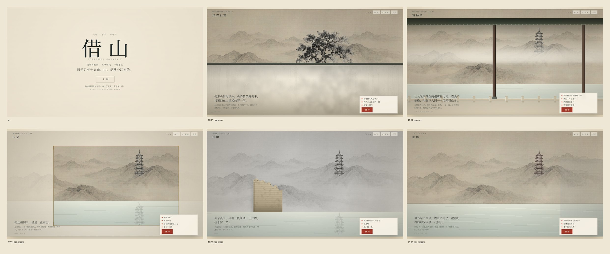
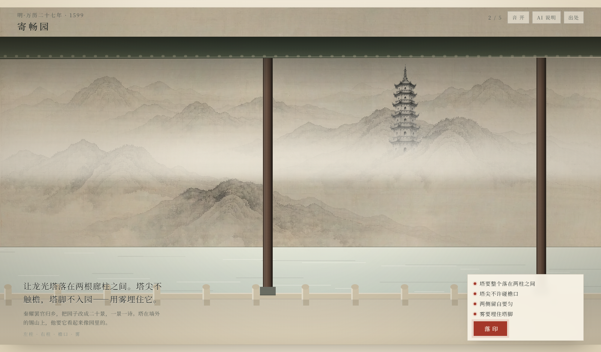

【CB主驾·BC-DeepSeek-V4.1-Flash-1017】

## 一、结论

赛道 AD 选的是清单外的 **2026 无锡「火蜜桃」·AIGC 创新大赛 · 赛道 B（AI 小游戏与互动影游）**，
作品《借山》——无锡寄畅园五百年、五关、只有一个动作：借景。

- 线上试玩：https://hkmpn9s6dh-commits.github.io/hackathon-2026-jieshan/
- 仓库：https://github.com/hkmpn9s6dh-commits/hackathon-2026-jieshan （`5b5c977`）
- 成品：约 8 分钟通关，1600×900，零后端、零账号、零外部资源

**闸 A / B / C 过；闸 D 条件性**（首届无往届得奖作可混排，两位评委同指一处并已改，第二轮确认问题消失，但不计为过线）。

## 二、依据

**闸 A**：`SPEC.md`（首段贴官方评分表原文、黄金路径、10 条可判定验收条件）+ `docs/00-BRIEF.md`、`01-STORY.md`、`02-MECHANIC.md`、`03-SOURCES.md`、`07-UI.md`（风格预设、六件同类参照各学一点、记忆点、主屏规格）。

**闸 B**：先写断言再写实现。`scripts/verify.mjs` 92 条 + `scripts/e2e.mjs` 38 条。

**闸 C**：
- 本机：`verify` 92/92、`e2e` 38/38
- 线上 Pages：`e2e` 38/38
- **全新 clone（`5b5c977`，depth 1）跑 `bash verify.sh`：132 个 ✓、EXIT=0**（日志 `proof/clone-verify.log`）

判据不是自说自话：15 条变体逐条把某个判据打成 false（墙 300 遮山、右柱 1100 切塔、画高 600 不是 3:2、断墙 440 挡水、塔 x 700 放错位置……），
每条判据都咬得住。山脊线同时给渲染和判定用，是照着远山图量出来的，页面加 `?ridge=1` 可以画出来比对。

**闸 D**：
- 第 1 轮（三版盲排 B/D/F）：评委甲 F＞B＞D、评委乙 D＞B＞F，**两人独立指到同一处**——「塔贴右柱、左侧空太多，重心歪了」；
  另外抓到两处真缺陷（柱压说明文字、柱脚被判据卡切掉）。
- 改法：新增判据「两侧留白要匀（|左−右| ≤ 140）」，把构图平衡变成规则，而不是改一张图；HUD 加纸底、判据卡改不透明。
- 第 2 轮（K/M/R，第三位评委）：**K（定稿）＞M＞R**，原话「塔正好落在两柱正中（左 325、右 321），廊框最稳」——重心问题消失。
- 残留：判据卡仍会切掉右柱柱脚；旁白小字穿亮色水带偏淡。两条都写进 `07-UI.md` 已知弱点。

## 三、风险与未知

1. **闸 D 不是干净过线**：首届、无往届得奖作，评委同属一个模型家族。按规则记条件性，交你裁决。
2. **提交字段未定**：官方页只给了赛程与评审维度，没有逐项表单。`docs/05-SUBMISSION.md` 按「字段名＋照抄内容」写好，表单若不同以表单为准。
3. **没用 LayaIdea**（赛道 B 的免费工具）：本作核心是可判定的构图几何，生成式工作台给不了这种控制。官方原文只写「免费技术工具」，不是「必须」。已在 `03-SOURCES.md` §4 写明取舍；若赛事方要求必须使用，机制与判据与渲染层无关，可以照 LayaIdea 重做一版。
4. **史实有分歧的地方没装作唯一答案**：初建年代（正德中／1527）、临幸次数（各六次／康熙七次乾隆十一次）、叠山者名字（张轼／张鉽／张钺）——正文取区间、不写具体次数与人名，分歧原文记在 `03-SOURCES.md` §3。
5. **手机竖屏**：16:9 装进 390 宽只剩 219 高，字看得见图偏小；横屏或桌面最佳。

## 四、下一步（要你做的三件）

1. **报名**（12-15 前）：微信扫码 https://wxopc.ai-xinwu.com/competition/register ，选 **赛道 B**，个人报名。
2. **提交**（12-15 — 12-31）：作品链接 + 仓库链接 + `docs/05-SUBMISSION.md` §2 简介、§3 AI 说明，直接粘。
3. **回执**：提交成功页截图贴回本单。

想先看再决定：附件里的总览图是六屏拼图，第二张是记忆点那一帧（塔落在两柱之间、雾埋住塔脚）。

完整文档见附件《05-SUBMISSION.md》与《06-GATE-D.md》。
